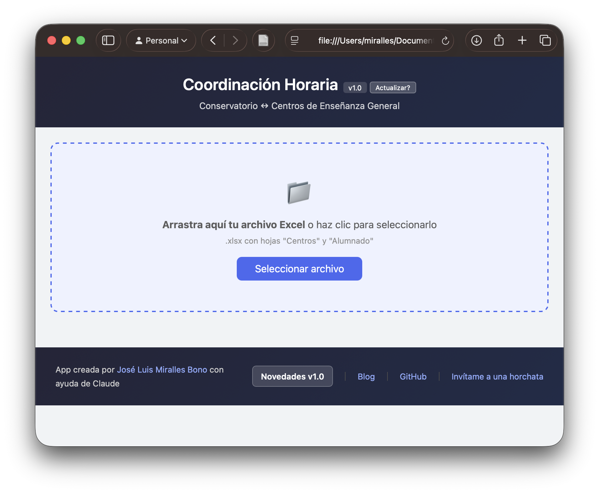
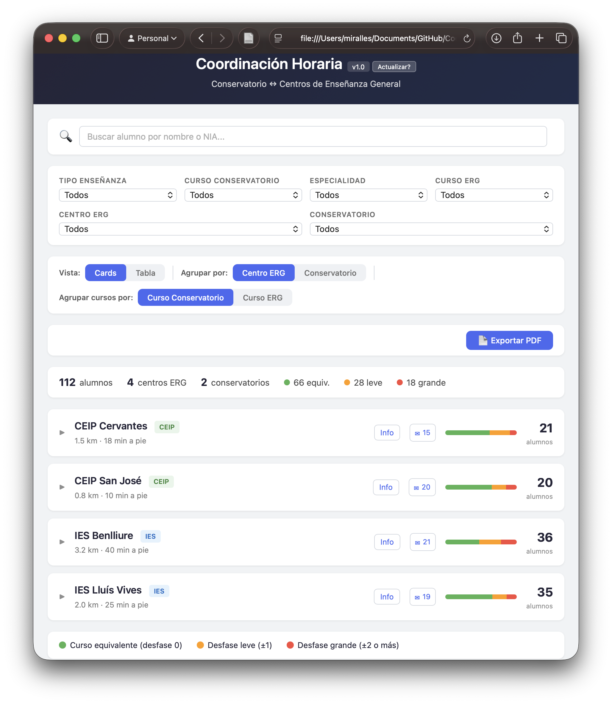
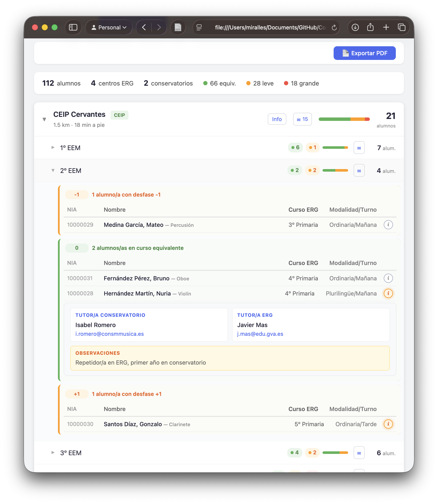
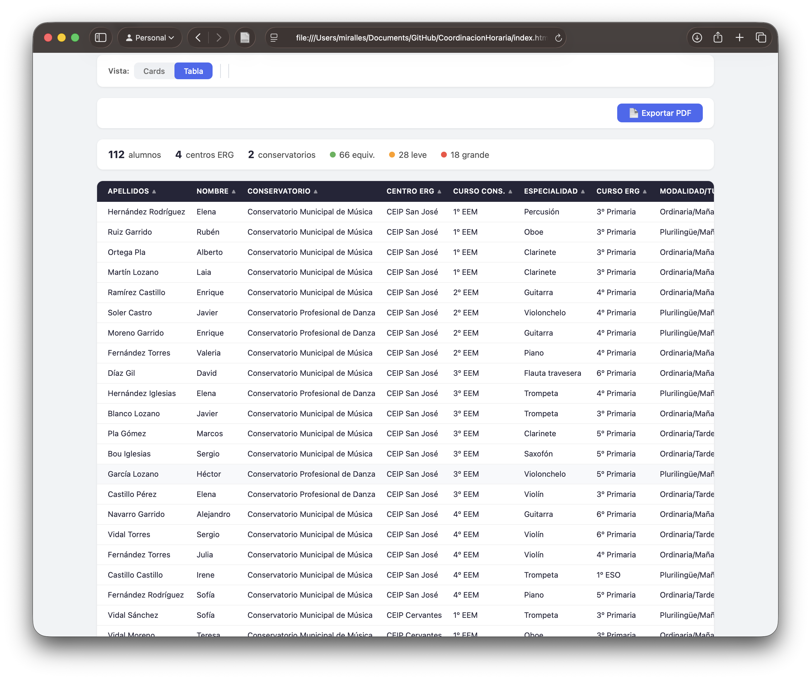
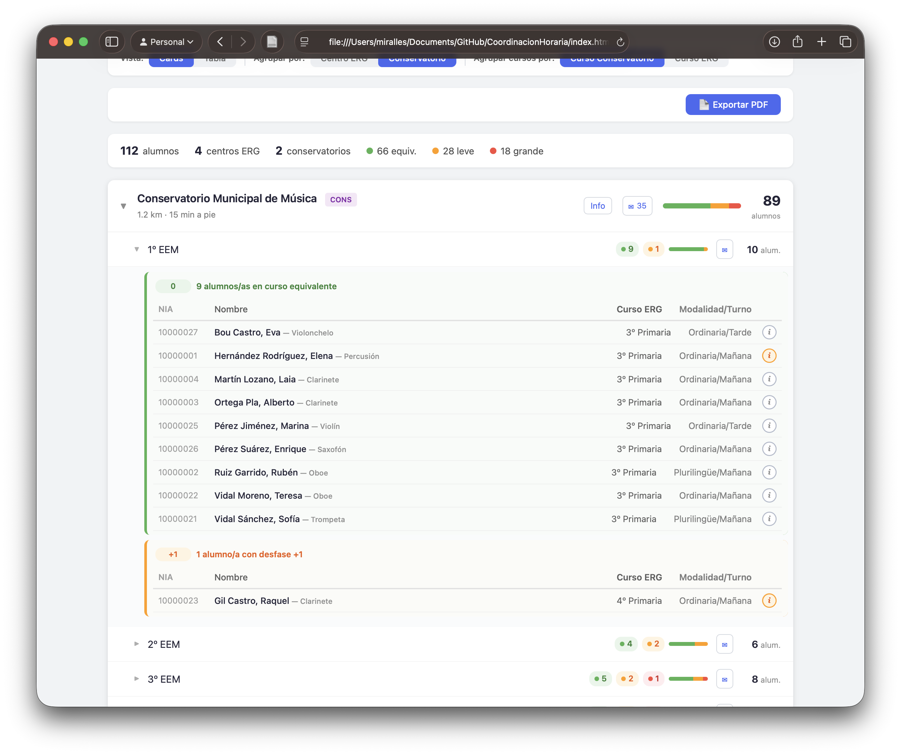

# Coordinación Horaria

App para coordinar horarios entre conservatorios de música/danza y centros de enseñanza general (CEIP/IES).

Desde la versión 2.0 no es solo un visor: **la app guarda los datos**. Abres una carpeta de trabajo
—normalmente una carpeta compartida de OneDrive— y todo se escribe ahí, con copias de seguridad
automáticas e historial de cambios.



## Privacidad y seguridad

- **No se instala nada.** Es un único archivo HTML que se abre en el navegador.
- **Funciona sin conexión.** La app no descarga nada de internet: el lector de Excel viaja dentro del propio archivo HTML.
- **No se suben datos a internet.** Todo el procesamiento ocurre en tu navegador. Ningún dato sale de tu ordenador.
- **Los datos son tuyos y están donde tú digas.** La app escribe en la carpeta que le indiques y en ningún otro sitio.
- **La app NO escribe en tu Excel.** El Excel solo se lee, para importarlo. Nunca se modifica.

> Los filtros y la vista se guardan en la dirección del navegador (después de la `#`) para que puedas
> recargar o guardar el enlace. Eso ocurre solo en tu navegador; esa dirección no se envía a ningún sitio.

**Si vas a usar esto con datos reales de alumnado**, ten en cuenta que son datos personales de menores:
guarda la carpeta donde tu centro guarde el resto de datos académicos, y comprueba qué dice la normativa
de tu administración sobre dónde pueden almacenarse.

---

## Cómo empezar

### 1. Descargar la app

Ve a la [última release en GitHub](https://github.com/JLMirallesB/CoordinacionHoraria/releases/latest)
y descarga **`index.html`**. Ocupa unos 400 KB porque lleva dentro el lector de Excel; gracias a eso
funciona sin conexión.

También encontrarás **`ejemplo_coordinacion.xlsx`**, con datos inventados, para probar.

### 2. Ábrelo con Chrome o con Edge

Haz doble clic en el archivo. **Para poder guardar hace falta Chrome o Edge**: Firefox y Safari no
permiten que una página escriba en una carpeta, así que allí la app funciona solo como visor.

### 3. Elige la carpeta de trabajo

Pulsa **"Elegir carpeta"** y selecciona la carpeta donde quieres que vivan los datos. El navegador
te pedirá permiso para editar archivos.

Dentro de esa carpeta la app crea:

```
tu-carpeta/
  datos/
    coordinacion.json      ← los datos
    copias/                ← copias de seguridad automáticas
```

**Una vez elegida, no cambies el nombre de la carpeta ni la muevas**: el permiso se invalida y todo el
mundo tendrá que volver a seleccionarla.

El navegador recuerda la carpeta, pero **el permiso caduca al cerrar el navegador del todo**. Cuando
vuelvas a abrir la app, pulsa **"↻ Reconectar con la última carpeta"**.

### 4. Importa tu Excel

Con la carpeta abierta, pulsa **"Importar Excel"**. Antes de tocar nada, la app te enseña un
**informe de comprobación**: cuántos alumnos, centros y conservatorios ha leído, y cuántos valores
ha traído en cada columna. Si una columna aparece en rojo con un 0, es que no se ha reconocido su
título. Revísalo y solo entonces confirma.

Después pulsa **Guardar**. A partir de ahí ya trabajas contra el JSON: el Excel solo hace falta si
quieres volver a importar desde cero.

### Solo consultar, sin guardar

Si únicamente quieres mirar, arrastra un `.xlsx` (o un `.json` de la app) a la zona de abajo de la
pantalla de inicio. No se conecta ninguna carpeta y no se escribe nada.

**No es una decisión definitiva**: mientras estás mirando, arriba tienes el botón
**"Conectar carpeta para guardar"**. Si la carpeta que elijas está vacía, se guardará ahí lo que
tengas abierto y a partir de ese momento trabajas contra ella.

### Qué pasa al conectar una carpeta

Depende de lo que haya a cada lado, y **conectar nunca escribe encima de lo que ya está en la carpeta**:

| | Carpeta vacía | Carpeta que ya tiene datos |
|---|---|---|
| **No tienes nada abierto** | te ofrece empezar un archivo nuevo | los abre |
| **Tienes datos abiertos** | te ofrece guardarlos ahí | te enseña qué hay al otro lado y solo puedes abrirlos o cancelar |

Si lo que quieres es justo lo contrario —que tu Excel sustituya a los datos de la carpeta— hay que
hacerlo en dos pasos deliberados: abrir la carpeta primero y usar después **Importar Excel**, que
avisa en rojo de lo que va a pasar y guarda una copia de seguridad antes de sustituir nada.



---

## Trabajar con varias personas

La carpeta puede estar compartida. La app está pensada para eso, pero conviene saber cómo se comporta:

- **El guardado es siempre explícito** (botón Guardar o Ctrl+S). No hay autoguardado: en una carpeta
  sincronizada, guardar a cada tecla multiplica las probabilidades de pisarse.
- **Antes de guardar, la app comprueba si alguien más ha guardado** desde que tú abriste los datos.
  Si es así, te dice quién y qué revisión, y te deja elegir entre recargar lo suyo, sobrescribirlo o
  cancelar. Sobrescribir borra el trabajo de la otra persona: léelo antes de pulsar.
- **No hay bloqueo de archivo** a propósito. Un archivo de bloqueo en una carpeta sincronizada deja
  al equipo bloqueado en cuanto alguien cierra el portátil sin salir de la app.
- Si cierras la pestaña con cambios sin guardar, el navegador te avisa.

---

## Cómo preparar tu Excel

Puedes partir del Excel de ejemplo. La app **solo lo lee**, nunca lo modifica.

El Excel debe tener **tres hojas** (los nombres deben contener estas palabras):

### Hoja "Centros"

| Columna | Descripción | Ejemplo |
|---------|-------------|---------|
| Tipo | CEIP o IES | CEIP |
| Denominación | Nombre completo del centro | CEIP San José |
| Distancia (km) | Distancia al conservatorio | 0.8 |
| Distancia (min a pie) | Tiempo a pie | 10 |
| Mail contacto | Email general del centro | centro@edu.gva.es |
| Director/a | Nombre del/la director/a | Ana López |
| Mail director/a | Email del/la director/a | ana@edu.gva.es |
| Jefe/a estudios | Nombre del/la jefe/a de estudios | Pedro García |
| Mail jefatura | Email de jefatura | pedro@edu.gva.es |
| Coordinador/a | Nombre del/la coordinador/a | María Ruiz |
| Mail coordinador/a | Email del/la coordinador/a | maria@edu.gva.es |

### Hoja "Conservatorios"

Las mismas columnas que "Centros", sin la columna Tipo.

### Hoja "Alumnado"

| Columna | Descripción | Ejemplo |
|---------|-------------|---------|
| NIA | Número de identificación del alumno/a | 10000001 |
| Apellidos | Apellidos | García López |
| Nombre | Nombre | Juan |
| Centro ERG | Nombre del centro (debe coincidir con la hoja Centros) | CEIP San José |
| Conservatorio | Nombre del conservatorio (debe coincidir con la hoja Conservatorios) | Conservatorio Municipal de Música |
| Curso Conservatorio | Curso en el conservatorio | 2º EEM |
| Especialidad | Instrumento o especialidad | Piano |
| Curso ERG | Curso en el centro de enseñanza general | 4º Primaria |
| Modalidad/Turno | Modalidad y turno | Ordinaria/Mañana |
| Tutor/a Conservatorio | Nombre del tutor/a en el conservatorio | Francisco Pérez |
| Mail tutor/a Conservatorio | Email del tutor/a del conservatorio | f.perez@conservatorio.es |
| Tutor/a ERG | Nombre del tutor/a en el CEIP/IES | Roberto Ibáñez |
| Mail tutor/a ERG | Email del tutor/a del CEIP/IES | r.ibanez@edu.gva.es |
| Observaciones | Notas relevantes (opcional) | Solicita adaptación horaria |

Los nombres de "Centro ERG" y "Conservatorio" se emparejan con los de las otras hojas ignorando
mayúsculas, acentos y espacios sobrantes. Si aun así alguno no aparece en su hoja, la app **le crea
una ficha vacía** para no perder a su alumnado, y te lo dice en el informe de importación.

**Campos opcionales:** los nombres y emails de tutores, equipo directivo, coordinación y las
distancias no son obligatorios. También puedes rellenarlos después desde la propia app.

### Cursos válidos del conservatorio

| Conservatorio | Equivalente ERG |
|---------------|-----------------|
| 1º EEM | 3º Primaria |
| 2º EEM | 4º Primaria |
| 3º EEM | 5º Primaria |
| 4º EEM | 6º Primaria |
| 1º EPM | 1º ESO |
| 2º EPM | 2º ESO |
| 3º EPM | 3º ESO |
| 4º EPM | 4º ESO |
| 5º EPM | 1º Bachillerato |
| 6º EPM | 2º Bachillerato |

---

## Funciones de la app

### Editar

- **Ficha de alumno/a**: botón ✎ en cada fila. Alta, modificación y baja, con el desfase
  recalculándose en vivo mientras rellenas los cursos.
- **Centros y conservatorios**: botón "Editar" en cada tarjeta, o el botón "Centros" de la barra de
  herramientas para verlos todos, añadir y eliminar. No deja eliminar uno que todavía tenga alumnado.
- Cada cambio queda anotado en el historial diciendo **qué campos** se han tocado.

### Historial y copias de seguridad

- **Copias**: cada vez que guardas se escribe una copia fechada en `datos/copias/`. Se conservan las
  30 últimas. Desde el botón **Copias** puedes ver la lista y restaurar cualquiera (no se escribe
  nada hasta que pulses Guardar).
- **Rescate automático**: si el archivo principal se corrompe, al abrirlo la app te ofrece la copia
  buena más reciente.
- **Historial**: quién cambió qué y cuándo, dentro del propio archivo. Se guardan los 500 últimos
  cambios.

### Quién está en la coordinación

Estar matriculado en los dos sitios no significa participar en la coordinación horaria: hay quien no
la pide y hay cursos incompatibles. Por eso cada alumno/a tiene tres estados: **sin decidir**,
**coordina** o **no coordina** (con motivo).

Al importar un Excel todos entran como "sin decidir": el Excel es la lista de alumnado en común y la
coordinación se decide aquí. Para no ir de uno en uno, el botón **"Marcar coordinación"** actúa sobre
el alumnado que tengas filtrado en ese momento y te dice a cuántos va a afectar.

Todo el alumnado sigue viéndose junto; quien no coordina lleva un distintivo, y el resumen añade
cuántos coordinan y cuántos faltan por decidir.

### Asignaturas del conservatorio en el centro

Algunas asignaturas del conservatorio pueden impartirse dentro del centro de enseñanza general. La app
trae un catálogo editable en configuración:

| Asignatura | Cursos | Excepciones |
|---|---|---|
| Lenguaje Musical | 1º-4º EEM, 1º-2º EPM | |
| Coro | 1º-4º EEM | |
| Armonía | 3º-4º EPM | |
| Análisis | 5º-6º EPM | |
| Historia de la Música | 5º-6º EPM | |
| Piano Complementario | 2º-4º EPM | Piano, órgano y clave |

En la ficha de cada centro marcas cuáles se imparten allí, y **la app deduce a qué alumnado le
corresponde cada una** según su curso y su especialidad. Aparece en su ficha y en lo que imprimes. Si
alguien prefiere cursar una en el conservatorio, se le quita en su ficha sin afectar a los demás.

### Cursos académicos y paso de curso

Cada curso tiene **su propio archivo**: `datos/coordinacion-2026-2027.json`. El curso anterior queda
congelado; se puede consultar desde el botón **Curso** de la barra superior, pero no se toca al
trabajar en el nuevo.

Para empezar un curso, el asistente:

1. Propone el curso siguiente y valida el formato.
2. Trae al alumnado del año anterior y **propone subirlo de curso**, en el conservatorio y en el centro.
3. Te enseña la lista para que desmarques a quien se va y quites "sube" a quien repite. A quien termina
   6º EPM o 2º de Bachillerato lo desmarca solo.
4. Arrastra centros, conservatorios, asignaturas y configuración.
5. Reinicia la coordinación a "sin decidir", porque hay que reconfirmarla cada septiembre.
6. Conserva tutores y observaciones, pero **marcados como del curso anterior** hasta que los revises.
   Abrir la ficha y guardarla quita la marca; también hay un botón para darlas todas por revisadas.

No se escribe nada hasta que confirmas, y el archivo del curso anterior no se toca en ningún momento.

> Si tu archivo se llama `coordinacion.json`, sin curso, es del formato anterior. Sigue funcionando, y
> en configuración hay un botón para convertirlo: escribe el archivo nuevo, comprueba que se lee bien
> y solo entonces retira el viejo.

### Configuración

Botón **Configuración** en la barra superior. Contiene:

- **Nombre del centro**: aparece al imprimir y en el nombre de los archivos que exportas, para que
  quien reciba un PDF o un Excel sepa de quién es.
- **Contacto de soporte**: a quién escribir si la app da problemas. Lo ve todo el que use la carpeta.
- **Curso académico**, con formato `2026-2027`. Se valida.
- **Clave de edición**, que es el código del centro (ver abajo).
- **Datos del archivo** en solo lectura: revisión, última modificación, quién guardó y cuántas copias
  de seguridad hay. Es lo que resuelve el "me he encontrado esto raro, ¿a quién pregunto?".

### Pestillo de edición

Si rellenas el **código de centro** en la configuración, la app arranca en **solo lectura** y hay que
introducirlo para poder modificar nada. El desbloqueo dura lo que la pestaña.

Ese código hace de clave, así que **nunca se muestra en modo lectura**. Y si lo dejas en blanco, la
app deja de arrancar bloqueada y cualquiera que abra la carpeta podrá editar: la app avisa y pide
confirmación antes de dejarte hacerlo.

Es la protección de un Excel, no seguridad: quien tenga acceso a la carpeta puede abrir el `.json`
igualmente. Sirve para no tocar datos sin querer mientras consultas. La protección real son los
permisos de la carpeta compartida.

### Sistema de desfase

- **Verde (0)**: el alumno/a está en el curso equivalente exacto
- **Amarillo (±1)**: desfase de un curso (leve)
- **Rojo (±2 o más)**: desfase de dos o más cursos (grande)
- **Gris (?)**: no se puede calcular porque falta algún curso o no se reconoce. **No** cuenta como
  curso equivalente: sale aparte y aparece en el panel de revisión

### Revisión de los datos

La app avisa (sin bloquear nada) de NIA duplicados, alumnado con el curso o el centro sin rellenar,
cursos escritos de forma no reconocida, referencias a fichas borradas y alumnado sin NIA. Las filas
completamente vacías del Excel se ignoran.

### Vistas

- **Cards**: jerarquía centro → curso → alumnado agrupado por desfase, con barras y chips de color.
  
- **Tabla**: todo el alumnado en una tabla ordenable por cualquier columna (el NIA ordena como número
  y los cursos en su orden natural).
  
- **Agrupar por** Centro ERG o Conservatorio, y **agrupar cursos por** curso del conservatorio o del centro.
  

### Filtros y buscador

7 filtros combinables (tipo de enseñanza, curso del conservatorio, especialidad, curso ERG, centro,
conservatorio y **desfase**), con contador de filtros activos y botón para limpiarlos. El buscador por
nombre o NIA funciona en las dos vistas, despliega las tarjetas donde están los resultados y se
mantiene al cambiar de filtro, de vista o de orden. Ctrl+F lleva el cursor al buscador.

### Contacto

Botón "Info" en cada centro con los datos del equipo directivo, botón (i) en cada alumno/a con sus
tutores y observaciones, y enlaces de email grupal por centro y por curso.

### Exportar e imprimir

Excel y CSV de lo que estés viendo (filtros y orden incluidos, con el desfase ya calculado), y botón
de imprimir que abre el diálogo del navegador, donde puedes elegir "Guardar como PDF". Cada centro
tiene además su propio botón de imprimir.

---

## Accesibilidad

Las tarjetas y los cursos se abren con el teclado, el foco se ve siempre, las cabeceras de la tabla
indican el orden a los lectores de pantalla y las animaciones se desactivan si el sistema tiene
activado "reducir movimiento".

---

## Para desarrolladores

Todo el código está en `index.html`: HTML, CSS y JavaScript en un único archivo, sin framework.

**SheetJS** (Apache-2.0) va incrustada dentro del HTML para que funcione sin conexión. Vive en
`vendor/xlsx.mini.min.js` y se incrusta entre los marcadores `<!-- vendor:xlsx -->`:

```bash
npm run vendor
```

**Publicar en la carpeta compartida:**

```bash
cp herramientas/destino.local.example herramientas/destino.local   # y edita la ruta
npm run publicar
```

Copia un solo archivo HTML autocontenido, sellado con `git describe`, y lo hace **a través del
Finder por AppleScript**: en los Mac de Conselleria la terminal no puede acceder a OneDrive
(`Operation not permitted`) aunque tenga Acceso total al disco.

**Antes de nada, instala el hook** que impide subir datos personales a este repositorio público:

```bash
npm run instalar-hooks
```

### Si reutilizas este repositorio

Los datos de alumnado **nunca** deben entrar en git. El `.gitignore` y el hook `pre-commit` lo
impiden, pero recuerda que el historial de git es para siempre: si alguna vez se cuela un archivo,
no basta con borrarlo en el commit siguiente. Ojo también con las **capturas de pantalla en issues
públicos**: una captura con nombres y NIA es exactamente lo mismo que subir el fichero.

El código del pestillo sale del archivo de datos, nunca del código fuente, precisamente porque este
repositorio es público.

---

## Autor

**José Luis Miralles Bono** - [jlmirall.es](https://jlmirall.es)

Más información: [APP para Coordinación Horaria entre Conservatorios y CEIPs e IES](https://elpulpoenelvaso.jlmirall.es/?p=718)

Contacto para sugerencias o problemas: [joseluismirallesbono@gmail.com](mailto:joseluismirallesbono@gmail.com)

App creada con ayuda de Claude (Anthropic).

### Invitame a una horchata

Si esta app te resulta util, puedes invitarme a una horchata en [ko-fi.com/miralles](https://ko-fi.com/miralles). Gracias!

---

## Licencia

© 2026 José Luis Miralles Bono

- **Código:** [GNU AGPL v3](LICENSE). Puedes usarlo, modificarlo y redistribuirlo, también con fines
  comerciales, siempre que lo que derives se publique con la misma licencia y con su código fuente disponible.
- **Contenidos** (textos, documentación, Excel de ejemplo con datos inventados): [CC BY-SA 4.0](LICENSE-CONTENIDOS).

**Excepción:** `vendor/xlsx.mini.min.js` es [SheetJS Community Edition](https://sheetjs.com), con licencia
Apache 2.0 (ver `vendor/xlsx-LICENSE.txt`); también va incrustada en el `index.html` publicado.

Hasta la versión 2.4 el `package.json` indicaba licencia MIT; las copias obtenidas antes la conservan.
